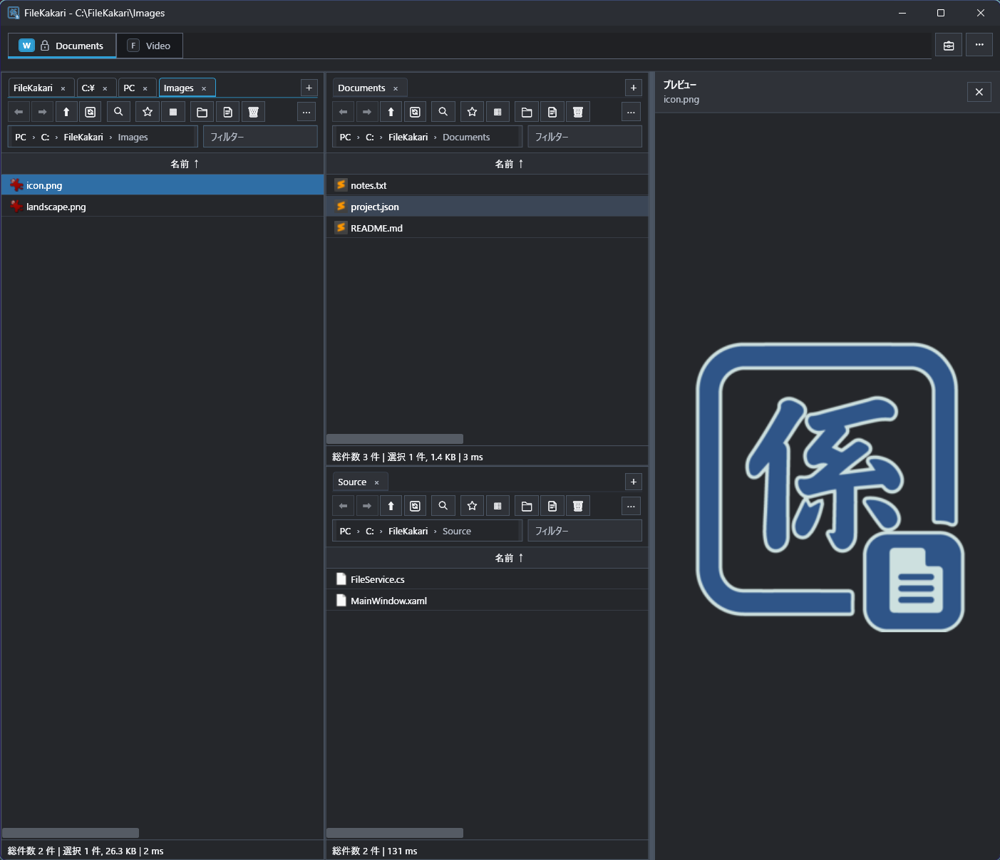
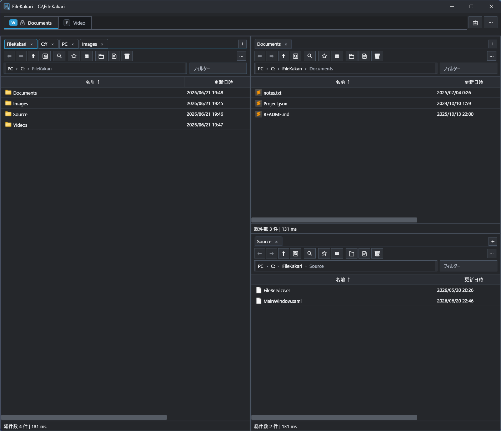
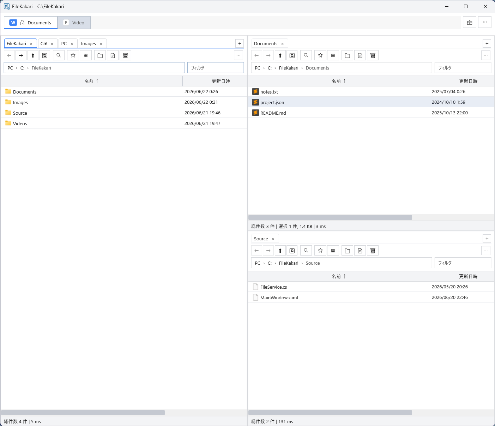

# FileKakari

**いくつもの作業環境を、ひとつのファイラーに。**

FileKakariは、複数の作業環境をひとつにまとめ、自由に切り替えたり、並べて使ったりできるWindows向けファイルマネージャーです。

Workspaceごとに複数のフォルダをタブやペインで配置し、自分の作業スタイルに合わせた画面を構築できます。

独自のインデックスDBや常駐サービスを使用せず、軽快なファイル操作を目指して開発しています。

> 現在開発中のプレリリース版です。機能や保存形式は変更される場合があります。

---

## Workspace — 自分だけの作業環境を構築

開発作業、写真・動画の整理、日常的なファイル管理。

異なる作業で必要になるフォルダや画面構成を、それぞれ独立したWorkspaceとしてまとめられます。

### 自由なレイアウト

Workspaceの内部では、複数のフォルダをサブタブや分割ペインで配置できます。

- 複数のフォルダをサブタブで管理
- ペインを分割して複数のフォルダを同時に表示
- ペインごとに表示形式やソートを設定
- ドラッグ＆ドロップによるタブやファイルの操作

作業内容に合わせて、自分に使いやすいレイアウトを構築できます。

  
  

### Workspaceを切り替える・並べて使う

複数のWorkspaceをひとつのウィンドウで管理し、作業に合わせて切り替えられます。

さらに、Workspaceタブを複数選択すると、異なるWorkspaceを横並びに同時表示できます。

それぞれのWorkspaceで構築したペインやサブタブの構成を活かしながら、複数の作業環境をひとつの画面で扱えます。

### Workspaceの保存と再利用

構築したペインやサブタブの構成は、Workspaceファイル（JSON形式）として保存できます。

作業ごとのフォルダ構成やレイアウトを再利用できるほか、相対パスを利用したWorkspaceの管理にも対応しています。

詳しくは [Workspace JSON仕様](docs/workspace-json.md) を参照してください。

---

## ファイルプレビュー

ファイルを別のアプリケーションで開かずに、FileKakari上で内容を確認できます。

F3キーでプレビュー表示を切り替え、フォルダ操作とファイル内容の確認を同じ画面で行えます。

※ 対応形式や利用可能なプレビューハンドラーは環境によって異なります。

---

## 主な機能

### ファイル操作

- コピー、移動、貼り付け、リネーム
- ゴミ箱への削除
- Undo（操作の取り消し）
- ファイル・フォルダのドラッグ＆ドロップ
- 複数選択、矩形選択

### ナビゲーション・表示

- フォルダ移動と履歴管理
- パスの直接入力
- ファイルの絞り込み
- 詳細表示、コンパクト表示、リスト表示
- ソートと表示設定
- ライト、ダーク、カスタムテーマ

### その他の機能

- User Commandによる外部ツールの実行
- Workspaceの保存と読み込み
- マルチペイン・マルチタブ構成

---

## ダウンロード・動作環境

配布版は [GitHub Releases](https://github.com/ffbeso/FileKakari/releases) からダウンロードできます。

**動作環境**

- Windows 11
- .NET 10 Desktop Runtime

※ 配布形式によっては.NET Runtimeの別途インストールは不要です。

---

## 設計方針

FileKakariは、Windows Explorerの完全な代替ではなく、日常的なファイル操作の快適さと、柔軟な作業環境の構築を重視しています。

- **非常駐・非DB** — 独自の常駐サービスやインデックスDBを必要としない
- **応答性を重視** — 非同期ファイル列挙と仮想化された一覧表示
- **シンプルな構成** — Windows/.NET標準機能を優先
- **柔軟な作業環境** — Workspaceを中心とした画面構成

### 制限事項

- Windows専用です。
- Windows Explorerとの完全互換は目指していません。
- Shell名前空間や仮想フォルダ、複雑なShell拡張には対応していません。
- ZIPファイルを通常のフォルダとして参照する機能はありません。
- 一部の機能は開発・改善中です。

---

## ドキュメント

- [キーボードショートカット](docs/shortcuts.md)
- [Workspace JSON](docs/workspace-json.md)
- [User Command](docs/user-command.md)
- [トラブルシューティング](docs/troubleshooting.md)
- [アーキテクチャ](docs/architecture.md)

## 開発について

FileKakariは、生成AIによる設計・実装支援を活用して開発しています。

仕様の決定、実際の動作確認、開発方針の判断、公開前の検証は開発者が行っています。

## コミュニティ・貢献

- [CONTRIBUTING.md](CONTRIBUTING.md)
- [SECURITY.md](SECURITY.md)

## ライセンス

[LICENSE](LICENSE)を参照してください。
